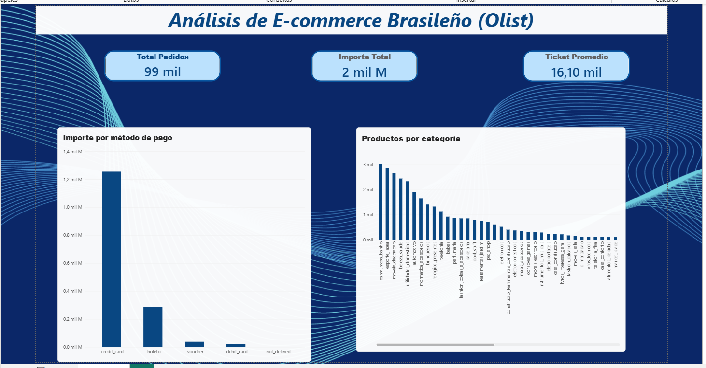

# Proyecto Final de Data Analytics
## Análisis del comportamiento de compra en el comercio electrónico brasileño
### Dataset Olist E-Commerce
Autora: Maria Alejabdra Muñoz Arnal
## Resumen Ejecutivo

Este proyecto analiza más de 99.000 pedidos realizados en el marketplace brasileño Olist para comprender patrones de compra, métodos de pago y comportamiento comercial.

A través de Python, Pandas y Power BI se desarrolló un proceso completo de análisis exploratorio que permitió identificar tendencias relevantes y construir un dashboard interactivo para el seguimiento de indicadores clave.


### Un análisis exploratorio utilizando el dataset Olist

Este proyecto tiene como objetivo transformar datos de comercio electrónico en información útil para comprender el comportamiento de los pedidos, los métodos de pago y los productos dentro de uno de los marketplaces más importantes de Brasil.

Mediante técnicas de limpieza, exploración y visualización de datos, se investigan diferentes dimensiones del negocio para identificar patrones, detectar oportunidades y apoyar la toma de decisiones basadas en datos.

---

# 📁 1. Origen de los datos

Para el desarrollo de este proyecto se utilizó el conjunto de datos:

**Brazilian E-Commerce Public Dataset by Olist**

Fuente:

https://www.kaggle.com/datasets/olistbr/brazilian-ecommerce

El dataset contiene información real sobre operaciones de comercio electrónico realizadas en Brasil.

Los archivos utilizados para el análisis fueron:

- olist_orders_dataset.csv
- olist_order_payments_dataset.csv
- olist_order_items_dataset.csv
- olist_products_dataset.csv

El conjunto analizado contiene:

- 99.441 pedidos
- 103.886 registros de pagos
- 112.650 ítems vendidos
- 32.951 productos

---

# 🧹 2. Preparación y limpieza de los datos

La preparación se realizó utilizando Python y Pandas.

El proceso incluyó:

- Auditoría de tipos de datos.
- Revisión de valores nulos.
- Exploración de dimensiones.
- Conversión de fechas.
- Traducción de estados de pedidos.
- Preparación de datos para visualización y análisis.

---

# 🎯 3. Objetivo del proyecto

Comprender cómo se comportan las ventas y los pedidos dentro del ecosistema de comercio electrónico brasileño.

La investigación busca responder las siguientes preguntas:

1. ¿Qué porcentaje de pedidos se entrega correctamente?
2. ¿Qué métodos de pago son los más utilizados?
3. ¿Cómo evoluciona la actividad comercial a lo largo del tiempo?
4. ¿Qué categorías de productos tienen mayor participación?

---

# 🔎 4. Principales hallazgos

## 4.1 Estado de los pedidos

El análisis mostró una elevada tasa de cumplimiento logístico.

Resultados principales:

- 96.478 pedidos entregados.
- 1.107 pedidos enviados.
- 625 pedidos cancelados.
- 609 pedidos no disponibles.

### Conclusión

La gran mayoría de los pedidos fueron completados satisfactoriamente, indicando una operación estable y eficiente.

---

## 4.2 Métodos de pago

La tarjeta de crédito fue el método de pago predominante.

### Conclusión

La tarjeta de crédito concentró más del 70% de las transacciones registradas,
convirtiéndose en el principal método de pago utilizado por los clientes.

---

## 4.3 Evolución temporal

El análisis temporal permitió observar la evolución de los pedidos durante el período analizado.

### Conclusión
Se observó un crecimiento sostenido de los pedidos durante gran parte del período analizado,
acompañado por fluctuaciones estacionales que podrían asociarse a campañas comerciales y períodos de alta demanda.

---

# 📊 5. Dashboard en Power BI

Se desarrolló un dashboard interactivo orientado al seguimiento de indicadores clave del negocio.

### KPIs

## Indicadores principales

| Métrica | Valor |
|----------|---------|
| Pedidos analizados | 99.441 |
| Pagos registrados | 103.886 |
| Productos vendidos | 112.650 |
| Productos únicos | 32.951 |
| Pedidos entregados | 96.478 |
| Pedidos cancelados | 625 |

### Visualizaciones

- Importe por método de pago.
- Productos por categoría.


## 📊 Vista del Dashboard
Dashboard interactivo desarrollado en Power BI para el análisis de pedidos, métodos de pago y categorías de productos del marketplace Olist.



---

# 🛠️ 6. Herramientas utilizadas

| Herramienta | Aplicación |
|------------|------------|
| Python | Procesamiento y análisis |
| Pandas | Limpieza y transformación |
| Matplotlib | Visualización |
| Seaborn | Análisis estadístico |
| Power BI | Dashboard interactivo |
| GitHub | Publicación y documentación |

---

# 📂 7. Estructura del repositorio

```text
data/
├── raw/

notebooks/
├── EDA_Olist.ipynb

dashboard/
├── Dashboard_Ventas.pbix

images/

README.md
requirements.txt
```

---
## Impacto para el negocio

Los resultados obtenidos permiten:

- Comprender las preferencias de pago de los clientes.
- Identificar categorías con mayor participación en ventas.
- Monitorear la evolución de la demanda.
- Detectar indicadores relevantes para la operación logística.
- Apoyar la toma de decisiones basada en datos.


# ✅ Conclusión

Este proyecto permitió integrar Python, Power BI y GitHub en un flujo completo de análisis de datos.

Los resultados obtenidos muestran cómo los datos pueden transformarse en información útil para comprender el comportamiento de clientes, pedidos y métodos de pago dentro del comercio electrónico.

La combinación de análisis exploratorio, visualización y dashboard interactivo permitió convertir datos operativos en información relevante para la toma de decisiones.

